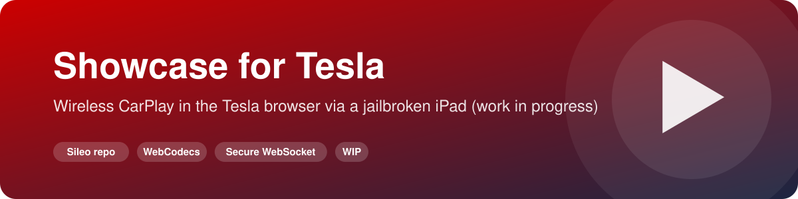
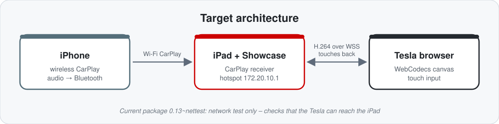

# Showcase for Tesla

[English](README.md) · **Deutsch**



In Arbeit: kabelloses CarPlay im Tesla-Browser, aufgebaut auf [Showcase](https://github.com/amineross/showcase) von Amine Rostane (Software-CarPlay-Empfänger für gejailbreakte iPads). Das iPad empfängt CarPlay vom iPhone und leitet den H.264-Stream unverändert per sicherem WebSocket an eine Seite im Tesla-Browser weiter. Die dekodiert ihn mit WebCodecs auf ein Canvas und schickt Berührungen zurück. Der Ton bleibt beim iPhone → Bluetooth → Tesla.



## Sileo-Quelle

```text
https://dr-apple.github.io/showcase-for-tesla
```

## Aktuelles Paket: Netzwerktest (0.13~nettest13)

Noch kein CarPlay. Prüft, ob der Tesla das iPad über dessen Hotspot erreicht.

- Braucht installiertes und verbundenes Showcase (oder Showcase-hud), damit der Hotspot läuft. Abhängigkeiten: `python3`, `openssl` und `network-cmds`.
- Statusseite auf dem iPad selbst (Safari), immer erreichbar: `http://127.0.0.1:8080` – zeigt, ob der Dienst läuft, der Hotspot gefunden wurde, 100.96.0.1 gesetzt ist, und den letzten Fehler.
- Solange der Hotspot (172.20.10.1) läuft, setzt ein Hintergrunddienst die Adresse `100.96.0.1/32` (standardmäßig auf `lo0`, damit Hotspot-Subnetz und dessen DHCP-Server unberührt bleiben; auf der Statusseite auf die Hotspot-Schnittstelle oder aus umschaltbar) – der Tesla-Browser sperrt private Adressen, erlaubt aber 100.64.0.0/10 – und liefert eine Testseite aus unter:
  - `http://100.96.0.1/` und `https://100.96.0.1/`
  - `http://172.20.10.1/` und `https://172.20.10.1/` (selbst signiertes Zertifikat)
- DHCP: Auf einem iPad nur mit WLAN antwortet iOS' eigener DHCP-Server (bootpd) ohne Router und DNS (kein Uplink), und der Tesla lehnt diese Adresse ab („IP-Adresse konnte nicht ermittelt werden“). Während CarPlay läuft, pausiert der Dienst bootpd und beantwortet DHCP selbst ([`src/dhcpd.py`](src/dhcpd.py)): Der Tesla bekommt Router und DNS 172.20.10.1, jeder andere Client (das iPhone) dieselbe Antwort wie von iOS und nutzt weiter mobile Daten. bootpd wird wieder geladen, sobald der Hotspot endet, der Dienst stoppt oder das Paket entfernt wird. Auf der Statusseite umschaltbar (ersetzen / automatisch / aus). Ein passives DHCP-Log ([`src/dhcpsniff.py`](src/dhcpsniff.py)) zeigt jede Anfrage und Antwort.
- Der Tesla bleibt nur in einem WLAN, das online aussieht. Nur für den Tesla (per DHCP) beantwortet ein kleiner DNS-Server ([`src/dnsd.py`](src/dnsd.py)) jeden Namen mit 172.20.10.1, und der Webserver beantwortet gängige Online-Prüfungen (ConnMan `X-ConnMan-Status: online`, `generate_204`, Apple-/Microsoft-/Firefox-Prüfungen). DNS-Anfragen und Prüfungen werden protokolliert.
- Die Seite zeigt, ob sie als sicherer Kontext gilt, ob WebCodecs vorhanden ist und ob ein (sicherer) WebSocket funktioniert. `/log` listet jeden Besuch.
- Endet der Hotspot, stoppen die Server und die zusätzliche Adresse wird entfernt. Zu Hause lauscht nichts.

### So läuft der Netzwerktest

1. Die Sileo-Quelle oben auf dem gejailbreakten iPad hinzufügen und **Showcase for Tesla** installieren.
2. Showcase (oder Showcase-hud) starten und CarPlay verbinden, damit der Hotspot des iPads läuft.
3. Auf dem iPad in Safari `http://127.0.0.1:8080` öffnen – alle Prüfungen sollten grün sein (Dienst läuft, Hotspot gefunden, 100.96.0.1 gesetzt).
4. Im Tesla mit dem Hotspot des iPads verbinden, den Browser öffnen und `https://100.96.0.1/` aufrufen (selbst signiertes Zertifikat akzeptieren).
5. Die Seite zeigt die Ergebnisse für *sicherer Kontext*, *WebCodecs* und *WebSocket*; `/log` auf dem iPad listet den Besuch.

Der Quellcode des Dienstes liegt in [`src/nettestd.py`](src/nettestd.py). Den Browser-Fähigkeitstest gibt es unter <https://dr-apple.github.io/showcase-hud/tesla-test/>.

Inoffiziell, nicht verbunden mit dem Showcase-Autor oder Tesla. GPL-3.0.
