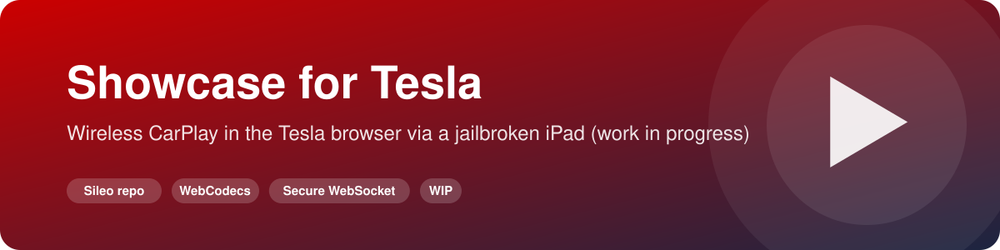
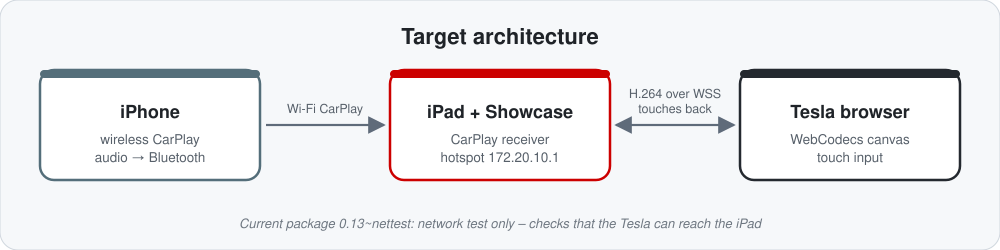

# Showcase for Tesla

**English** · [Deutsch](README.de.md)



Work in progress: wireless CarPlay in the Tesla browser, built on [Showcase](https://github.com/amineross/showcase) by Amine Rostane (software CarPlay receiver for jailbroken iPads). The iPad receives CarPlay from the iPhone and forwards the H.264 stream unchanged over a secure WebSocket to a page in the Tesla browser, which decodes it with WebCodecs onto a canvas and sends touches back. Audio stays on the iPhone → Bluetooth → Tesla.



## Sileo source

```text
https://dr-apple.github.io/showcase-for-tesla
```

## Current package: network test (0.13~nettest13)

Not CarPlay yet. Checks that the Tesla can reach the iPad over the iPad's hotspot.

- Needs Showcase (or Showcase-hud) installed and connected, so the hotspot is up. Depends on `python3`, `openssl` and `network-cmds`.
- Status page on the iPad itself (Safari), always available: `http://127.0.0.1:8080` – shows whether the service runs, the hotspot was found, 100.96.0.1 is set, and the last error.
- While the hotspot (172.20.10.1) is up, a background service adds `100.96.0.1/32` (default on `lo0`, so the hotspot subnet and its DHCP server stay untouched; switchable on the status page to the hotspot interface or off) (the Tesla browser blocks private addresses but allows 100.64.0.0/10) and serves a test page on:
  - `http://100.96.0.1/` and `https://100.96.0.1/`
  - `http://172.20.10.1/` and `https://172.20.10.1/` (self-signed certificate)
- DHCP: on a Wi-Fi-only iPad, iOS's own DHCP server (bootpd) answers without router and DNS (no uplink), and the Tesla rejects that lease ("IP address could not be detected"). While CarPlay runs, the service pauses bootpd and serves DHCP itself ([`src/dhcpd.py`](src/dhcpd.py)): the Tesla gets router and DNS 172.20.10.1, every other client (the iPhone) gets the same answer as from iOS, so it keeps using mobile data. bootpd is loaded again when the hotspot stops, the service stops or the package is removed. Switchable on the status page (replace / auto / off). A passive DHCP log ([`src/dhcpsniff.py`](src/dhcpsniff.py)) shows every request and answer.
- The Tesla only keeps a Wi-Fi that looks online. For the Tesla only (via DHCP), a small DNS server ([`src/dnsd.py`](src/dnsd.py)) answers every name with 172.20.10.1, and the web server answers common connectivity checks (ConnMan `X-ConnMan-Status: online`, `generate_204`, Apple/Microsoft/Firefox checks). DNS queries and checks are logged.
- The page shows whether it counts as a secure context, whether WebCodecs is there, and whether a (secure) WebSocket works. `/log` lists every visit.
- When the hotspot stops, the servers stop and the extra address is removed. Nothing listens at home.

### How to run the network test

1. Add the Sileo source above on the jailbroken iPad and install **Showcase for Tesla**.
2. Start Showcase (or Showcase-hud) and connect CarPlay so the iPad's hotspot is up.
3. On the iPad open `http://127.0.0.1:8080` in Safari – all checks should be green (service running, hotspot found, 100.96.0.1 set).
4. In the Tesla, join the iPad's hotspot, open the browser and go to `https://100.96.0.1/` (accept the self-signed certificate).
5. The page shows *secure context*, *WebCodecs* and *WebSocket* results; `/log` on the iPad lists the visit.

The service source is in [`src/nettestd.py`](src/nettestd.py). The browser capability test is at <https://dr-apple.github.io/showcase-hud/tesla-test/>.

Unofficial, not affiliated with the Showcase author or Tesla. GPL-3.0.
